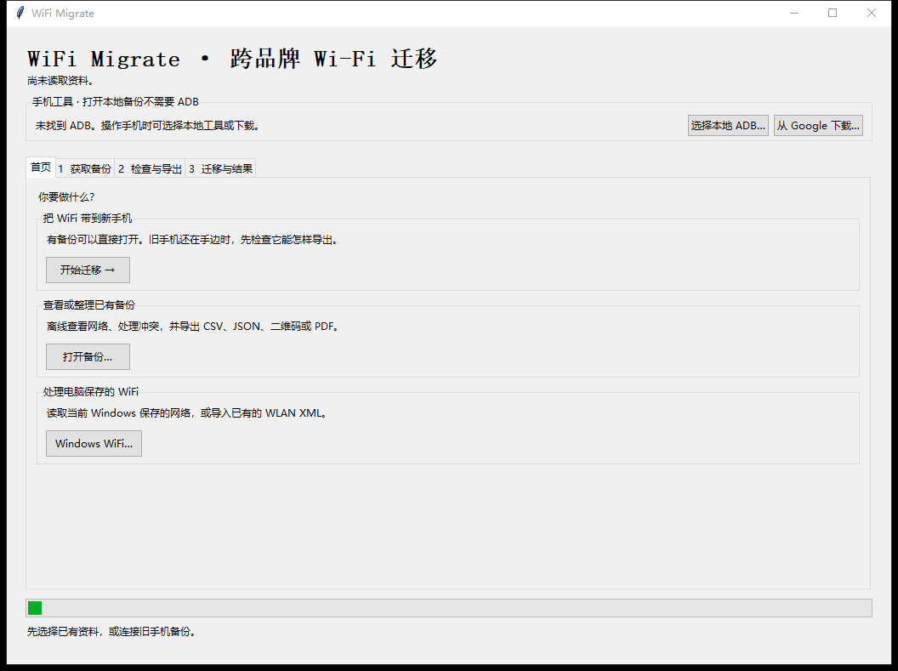
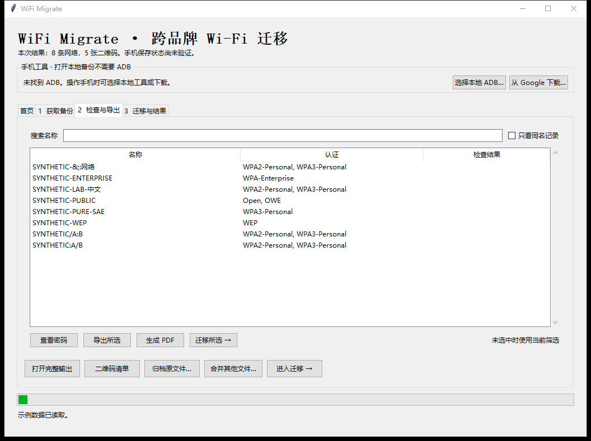
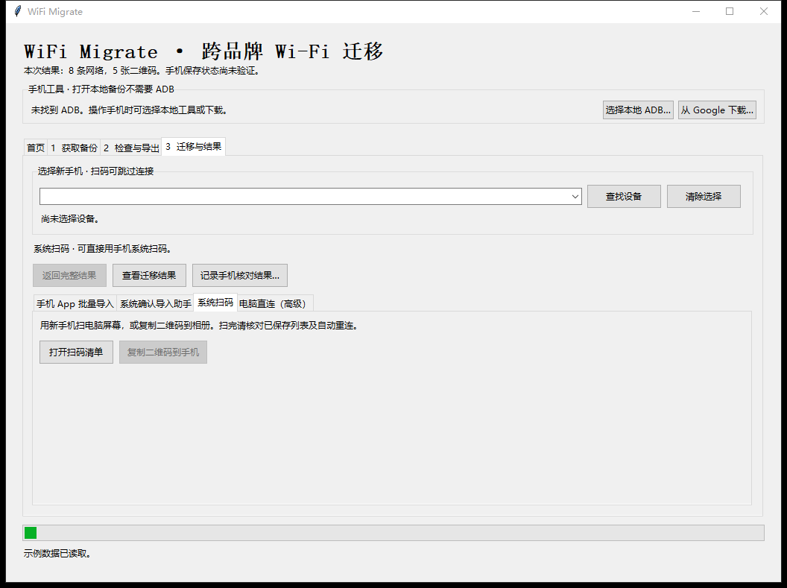

# WiFi Migrate

[简体中文](README.md) | [English](README.en.md)

> **Try WiFi Password Manager first.** If it works with Shizuku on both phones, its native backup and restore workflow is usually the simplest option. WiFi Password Manager can view saved networks, import and export JSON, and produce GZip or encrypted exports.
>
> [WiFi Password Manager on GitHub](https://github.com/Khh-vu/wifi-password-manager) · [F-Droid](https://f-droid.org/packages/io.github.wifi_password_manager/) · [Shizuku](https://github.com/RikkaApps/Shizuku)

**Cross-brand Android Wi-Fi Migration Toolkit · 0.3.0 Beta**

A Windows companion for organizing backups, reviewing conflicts, and selecting networks to transfer. Use it when the phones need different restore methods, when merging backups, or when your source is a legacy ADB backup or a Windows WLAN profile.

## Quick Start

1. Install **Python 3.10 or newer with Tkinter**.
2. [Download the 0.3.0 Beta](https://github.com/YesterdayDreamer/android-wifi-migrate/releases/tag/v0.3.0-beta) source ZIP and extract it.
3. Double-click **Start.cmd**. The first launch creates a project-local `.venv` and installs the base dependencies. Later launches reuse that environment. Administrator access is normally unnecessary.
4. Choose **Open backup** and select `examples/synthetic-settings.xml` to try the catalog, CSV/JSON exports, and scan sheet offline.

**ADB is only needed for phone-connected operations.** The app discovers local ADB, accepts a manual path, or offers a Google download. For optional PDF support, run this from the project directory:

```powershell
.\.venv\Scripts\python.exe -m pip install -e ".[pdf]"
```

If dependency installation fails, the launcher shows the pip error. Plaintext CSV/JSON exports remain available. QR generation and encrypted Android backup processing may be unavailable. See the [usage and troubleshooting guide](docs/toolkit.md).

## Screenshots

Captured from the running Windows app using synthetic data.



<details>
<summary>View the network catalog and migration page</summary>





</details>

## Import, organize, and export

- Open WPM plaintext or GZip JSON, supported Android Backup/TAR/settings files, CSV/JSON, and Windows WLAN XML. Windows can export locally saved WLAN profiles. Legacy ADB Backup depends on the old phone firmware. Re-export encrypted WPM backups in the original app.
- Search, filter, and merge backups while keeping conflicting records. Export a selected subset or the full collection.
- Export extended JSON, CSV, QR PNGs, offline scan sheets, and A4 PDF. Archive originals separately with SHA-256 verification.

## Migration methods

| Method | When and how to use it |
| --- | --- |
| **WiFi Password Manager + Shizuku · recommended** | Prefer native app backups. Generated compatibility JSON still needs device testing. Try a small subset and check the app's On-device category. |
| **Android Import Helper · experimental** | Android 11+ can confirm up to five records per batch through system settings. The helper exports system results. |
| **Direct ADB · experimental** | Preview, try one record, check the saved list, then confirm before batch writes. |
| **QR codes** | Scan the screen or copy the images to the phone. Pure OWE and Open/OWE transition networks are skipped by the QR route. WPA2/WPA3 transition QR codes are explicitly labeled as WPA2-only compatibility options. |

The source and target phones are selected separately. File transfer, system saving, and automatic reconnection have separate checks. The [compatibility notes](docs/compatibility.md) cover native WPM migration from HarmonyOS 4.2 to vivo, Huawei USB Shizuku, Xiaomi helper installation and transfer, and read-only ADB previews on Huawei and Xiaomi. Helper system saving, ADB writes, and automatic reconnection still await device testing.

## Privacy and license

Data processing is local. Backups, CSV/JSON, QR images, PDF, and offline HTML with embedded QR images can contain credentials. Migration reports can include device identifiers. Check files before sharing them. See [SECURITY.md](SECURITY.md) and the [MIT License](LICENSE).
