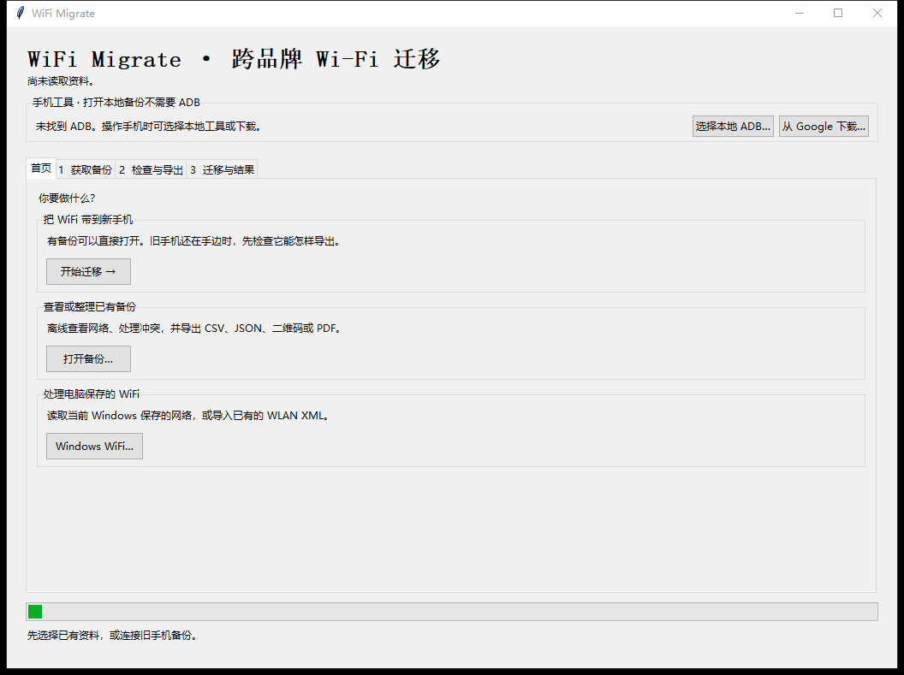
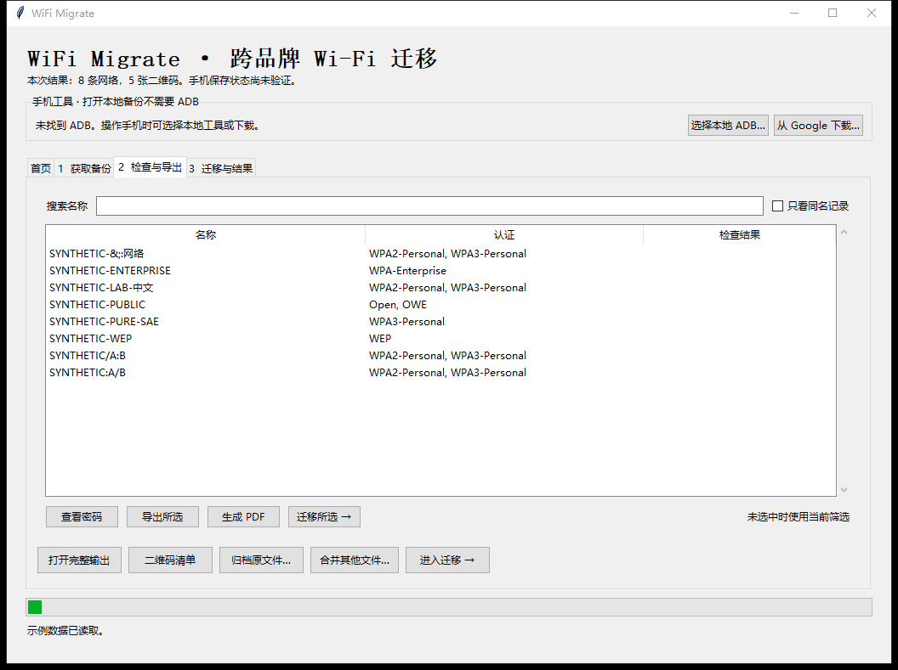
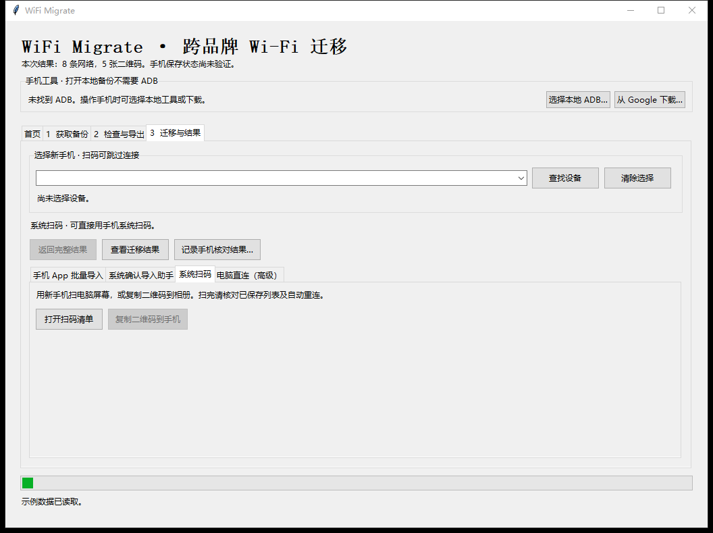

# WiFi Migrate

[简体中文](README.md) | [English](README.en.md)

> **先试 WiFi Password Manager。** 如果它和 Shizuku 在新旧两台 Android 手机上都能用，直接在 App 内导出并恢复原生备份通常最方便。WiFi Password Manager 支持查看已保存网络、导入和导出 JSON，以及 GZip 和加密导出。
>
> [WiFi Password Manager · GitHub](https://github.com/Khh-vu/wifi-password-manager) · [F-Droid](https://f-droid.org/packages/io.github.wifi_password_manager/) · [Shizuku](https://github.com/RikkaApps/Shizuku)

**跨品牌 Android Wi-Fi 迁移工具 · 0.3.0 Beta**

在 Windows 上整理多种备份、检查冲突并选择要迁移的网络。适合两台手机需要不同恢复方式、想合并多份备份，或手头只有旧 ADB 备份及 Windows WLAN 配置的情况。

## 快速开始

1. 安装带 Tkinter 的 **Python 3.10 或更新版本**。
2. [下载 0.3.0 Beta](https://github.com/YesterdayDreamer/android-wifi-migrate/releases/tag/v0.3.0-beta) 的源码 ZIP 并解压。
3. 双击 **Start.cmd**。首次启动会在项目目录创建 `.venv`，安装基础依赖。之后会复用该环境，通常无需管理员权限。
4. 点击「打开备份」并选择 `examples/synthetic-settings.xml`，即可离线试用网络列表、CSV/JSON 导出和扫码清单。

**ADB 仅用于连接手机的操作。** 软件会自动查找本机 ADB，也支持手动选择或按需从 Google 下载。生成 PDF 是可选功能，在项目目录执行：

```powershell
.\.venv\Scripts\python.exe -m pip install -e ".[pdf]"
```

如果首次安装依赖失败，窗口会显示 pip 错误。明文输入仍可导出 CSV/JSON，二维码和加密备份可能暂不可用。使用说明与故障排查见 [操作指南](docs/toolkit.md)。

## 界面预览

以下为 Windows 实际运行截图，使用虚构示例。



<details>
<summary>查看网络列表和迁移页面</summary>





</details>

## 备份、整理与导出

- 读取 WPM 明文或 GZip JSON、支持的 Android Backup/TAR/设置文件、CSV/JSON 和 Windows WLAN XML。也可读取 Windows 本机保存的 WLAN。旧式 ADB Backup 取决于旧机固件，加密 WPM 导出请在原 App 解密后重新导出。
- 搜索、筛选和合并备份，保留同名冲突，选择单条或批量导出。
- 导出扩展 JSON、CSV、二维码 PNG、离线扫码清单及 A4 PDF。原始备份可独立归档并用 SHA-256 校验。

## 选择迁移方式

| 方式 | 适用情况与步骤 |
| --- | --- |
| **WiFi Password Manager + Shizuku · 推荐** | 优先使用 App 原生备份。工作台生成的兼容 JSON 尚待真机验证，建议先试少量并检查 App 的 On-device 分类。 |
| **Android 导入助手 · 实验性** | Android 11+ 可用系统确认界面，每批最多 5 条。助手可导出系统结果报告。 |
| **电脑 ADB 直写 · 实验性** | 先只读预览，再试存一条、检查系统列表并确认，才可批量保存。 |
| **二维码** | 适合少量迁移，可扫电脑屏幕或复制图片到手机。纯 OWE 和 Open/OWE 过渡网络不会生成开放二维码，WPA2/WPA3 过渡码仅携带标记过的 WPA2 兼容项。 |

旧机和新机在界面中分别选择。文件复制、系统保存和自动重连分别核对。[兼容性记录](docs/compatibility.md)列出了鸿蒙 4.2 → vivo 的 WPM 原生迁移、华为 USB Shizuku、小米助手安装和传输，以及华为和小米的 ADB 只读预览。助手系统保存、ADB 实际写入及自动重连仍待验证。

## 隐私与许可证

数据在本地处理。备份、CSV/JSON、二维码、PDF 和内嵌二维码的离线 HTML 都可能含有凭据。迁移报告也可能含设备标识。公开分享前请检查文件内容。详见 [SECURITY.md](SECURITY.md) 和 [MIT 许可证](LICENSE)。
